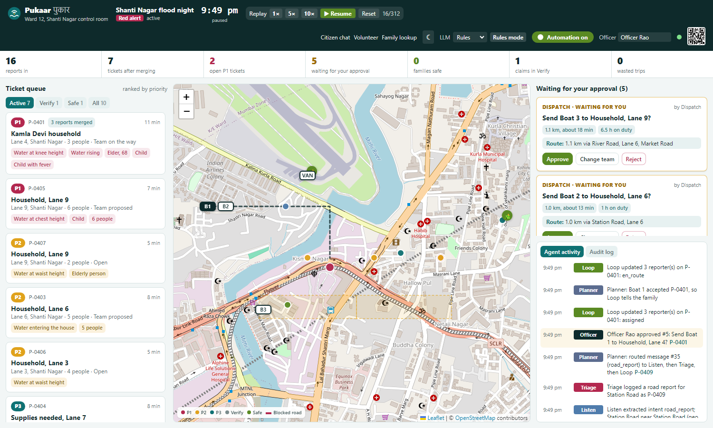
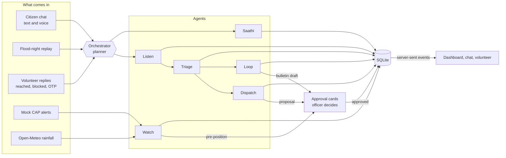

# Pukaar पुकार

**AgentX Hackathon 2026 · PS-03: Multi-agent disaster response coordinator**

India can send a flood alert to every phone, but the calls for help that come back arrive as chaos: the same family reported five times in three languages, rumours, reposts about people rescued hours ago, and boats sent to the wrong lane. Pukaar is a team of six AI agents that turns every call for help into **one ticket**, ranks it with written reasons, proposes the right rescue team, **waits for a human officer to approve**, keeps every reporter informed in their own language, and **closes the ticket** only when the family is confirmed safe. Agents do the paperwork. Humans send the boats.



| Citizen chat (Hindi) | Volunteer view | Is my family safe? |
| --- | --- | --- |
|  |  |  |

## What it does

- **One family, one ticket.** A Hindi voice note, an English post from a daughter in Pune and a Hinglish SMS from a neighbour become one P1 ticket, with the reason for each merge written out. Uncertain matches are never merged automatically; they go to the officer as "Possible duplicate: merge?".
- **Explainable priority.** An additive rule set, shown as chips: *water at knee height, water rising, elder 68, child with fever, phone at 14%*.
- **Human gates, enforced in the backend.** No agent can dispatch a team, send a public bulletin, downgrade a P1, close a ticket without the family, or apply an uncertain merge. Each needs an officer's approval, and `backend/tests/test_safety.py` proves it.
- **Closes the loop.** Every linked reporter gets updates in their language. Closing needs the volunteer to enter the family's OTP. Later reposts about a rescued family get "Rescued at 8:12 PM, safe at Camp 3" automatically.
- **Verify lane.** "The dam has burst" is checked against the river gauge and alert feed, and parked for verification instead of becoming a rescue call.
- **Learns the streets.** A volunteer's "Lane 6 blocked" goes into area memory (it fades unless confirmed again) and every affected route is replanned.
- **Saathi, the safety companion.** Answers "what do I do now?" only from approved playbooks in English, Hindi and Marathi. For gas, fire, live wires or someone unconscious, the first line is always the emergency number.
- **Kill switch.** Automation off: agents keep logging and ticketing, but nothing is sent and nothing new is proposed.

## Architecture



| Agent | Job | Tools |
| --- | --- | --- |
| **Listen** | Detects Hindi, Marathi, Hinglish or English; extracts people, vulnerable members, medical need, water level, landmark, battery and danger words; asks one follow-up if the location or head count is missing. | `extract_report`, `geocode_landmark`, `ask_followup` |
| **Triage** | Matches reports to existing tickets (sender, family name across scripts, household registry, landmark, details, embeddings), scores priority, sends contradicted claims to Verify, recognises reposts about families already safe. | `find_similar_tickets`, `create_ticket`, `merge_into_ticket`, `score_priority`, `flag_for_verification` |
| **Dispatch** | Picks the best free team by skill (medic for medical needs), road distance and hours on duty; routes around blocked roads; replans; proposes, never sends. Supplies go to the van. | `list_free_teams`, `compute_route`, `create_approval`, `replan_routes` |
| **Loop** | Status updates to every linked reporter, auto-replies to reposts, FAQ answers, stale-ticket re-pings, bulletin drafts. | `send_message`, `draft_bulletin`, `answer_faq` |
| **Saathi** | Safety steps from the playbooks only; emergency number first for danger; escalates the ticket. | `search_playbook`, `escalate_danger` |
| **Watch** | Reads the CAP feed and Open-Meteo, marks watch zones, keeps area memory, proposes pre-positioning. | `read_alerts`, `get_rainfall`, `mark_road_blocked`, `propose_preposition` |

The planner logs every routing decision ("Planner: routed message #12 (rescue) to Listen, then Triage, then Loop, then Dispatch") and every tool call goes into the audit log. More detail is in [docs/architecture.md](docs/architecture.md).

## Setup

You need **Python 3.11 or newer** and **Node.js 18 or newer**. Nothing else is required for rules mode.

```bash
# macOS or Linux
./start.sh

# Windows (PowerShell)
.\start.ps1
```

The script creates a Python virtual environment, installs the packages, builds the frontend and serves everything on **http://localhost:8000**:

| Page | URL |
| --- | --- |
| Officer dashboard | http://localhost:8000/ |
| Citizen chat | http://localhost:8000/chat |
| Volunteer view | http://localhost:8000/volunteer |
| Is my family safe? | http://localhost:8000/family |

Press **▶ Start** in the dashboard header to replay the flood night at 1×, 5× or 10×.

### LLM modes

Pukaar runs fully without any model. The mode is shown in the dashboard header and can be switched there.

**Rules mode (default).** Deterministic extraction in four languages, fuzzy matching and template replies. Nothing to install.

**Ollama mode.** Listen extracts reports through a tool call to a local model, Saathi lets the model choose the playbook (the reply text still comes only from the playbook), and Triage uses embeddings to compare messages.

1. Install Ollama from https://ollama.com.
2. Pull the models. Pukaar picks `qwen2.5:7b` on machines with 16 GB of RAM or more and `qwen2.5:3b` otherwise:
   ```bash
   ollama pull qwen2.5:3b          # or qwen2.5:7b with 16 GB+ RAM
   ollama pull nomic-embed-text    # optional, for duplicate matching
   ```
3. Start Pukaar in Ollama mode: `LLM_MODE=ollama ./start.sh` or `.\start.ps1 -Mode ollama`.

Every model call has a timeout (`LLM_TIMEOUT`, default 6 seconds). If Ollama is stopped, slow or missing the model, that call falls back to rules and the header says so. Set `OLLAMA_MODEL` to use a different model, and `OLLAMA_HOST` if Ollama is not on `localhost:11434`. The model is never offered tools that act: it cannot send messages, create approvals or move teams.

### Public demo link

To let judges open the citizen chat on their phones, expose the app with a free Cloudflare quick tunnel (no account needed):

```bash
cloudflared tunnel --url http://localhost:8000
```

Open the `https://….trycloudflare.com` address it prints. The QR code in the dashboard header then points at that public `/chat` page. Install `cloudflared` from https://developers.cloudflare.com/cloudflare-one/connections/connect-networks/downloads/.

### Development

```bash
cd backend && .venv/bin/python -m uvicorn app.main:app --reload   # API on :8000 (.venv\Scripts on Windows)
cd frontend && npm run dev                                          # Vite on :5173, proxies /api
cd backend && .venv/bin/python -m pytest                            # tests
cd backend && .venv/bin/python scripts/generate_flood_night.py     # regenerate the night
cd backend && .venv/bin/python scripts/evaluate.py --modes rules ollama
```

## Evaluation

`backend/scripts/evaluate.py` replays the 311-message synthetic night (Hindi, Marathi, Hinglish and English, with hidden ground truth) through the real pipeline and through a first-come-first-served baseline, where every request is a new job and three boats take jobs in arrival order. Full results and method: [docs/eval-report.md](docs/eval-report.md).

| Measure | First-come-first-served | Pukaar (rules) | Pukaar (Ollama, llama3.2:1b) |
| --- | --- | --- | --- |
| Requests turned into jobs or tickets | 210 | 101 | 108 |
| Duplicate-merge F1 (after officer review) | 0 (no merging) | 0.79 | 0.71 |
| Median time to assign a P1 family | 463 min | 20 min | 16 min |
| 90th percentile time to assign a P1 family | 1253 min | 172 min | 200 min |
| P1 families assigned by the end | 28/28 | 25/28 | 24/28 |
| Boat or van trips | 210 | 56 | 54 |
| Wasted trips (already rescued, rumour or duplicate) | 131 | 15 | 15 |
| Supplies requests sent on rescue boats | 24 | 0 (van only) | 0 (van only) |
| Rumours caught in the Verify lane | 0/15 | 15/15 | 15/15 |

Notes on reading this table:

- The Ollama column used `llama3.2:1b`, the only model pulled on the build machine; 169 of its 317 model calls timed out or returned unusable output and fell back to rules. The recommended `qwen2.5:3b` or `qwen2.5:7b` has not been evaluated yet: pull it and run `scripts/evaluate.py --modes rules ollama` to get its numbers.
- The baseline eventually reaches every P1 family only because it keeps running long after the night ends (its 90th percentile is about 21 hours). Pukaar is scored up to 90 minutes after the last message; the P1 families it had not reached by then are counted as not assigned.
- Merge F1 is after a simulated officer reviews the 'possible duplicate' cards; automatic merges alone score lower (0.57 in rules mode). See the report for both rows.

These are real numbers from a synthetic night, not field results. Two cautions from the report: the rules extractor and the message generator share vocabulary, so rules-mode field accuracy is an upper bound; and the baseline gets no typing time and ignores rumours, which flatters it.

## Safety tests

`cd backend && .venv/bin/python -m pytest` runs 44 tests, including `tests/test_safety.py`, which proves that:

- no team can go `en_route` without an approved approval for exactly that team and ticket;
- public bulletins are never marked sent without approval;
- the kill switch stops every outgoing message and every new proposal;
- Saathi's gas-leak reply starts with an emergency number and contains only playbook steps and fixed templates (in English, Hindi and Marathi);
- family lookup never returns an address or phone number;
- low-confidence or conflicting duplicates are never merged automatically, and a new family near a rescued one is never told it was rescued;
- the full flow works in rules mode with Ollama stopped;
- a P1 cannot be downgraded, and a ticket cannot be closed without the family, unless an officer approves.

## What's simulated

Be clear about this when you demo:

- **Ward 12, Shanti Nagar is fictional.** It is placed on the Kurla stretch of the Mithi river in Mumbai, but its nine lanes, landmarks and road graph are a simplified invention that does not match the real streets on the map. Every household, name and message is made up, and every phone number uses the fake pattern `+91 90000 xxxxx`.
- **Channels.** WhatsApp, SMS, posts and calls are represented by a web chat and by labels on replayed messages. No real messaging service is connected.
- **Voice notes** use the browser's own speech recognition (Chrome, Edge or Safari). The replay contains already-transcribed text.
- **Alerts and sensors.** The CAP alerts are mock files in SACHET's format, and the river gauge is a mock file. Rainfall is real, from Open-Meteo, but it is today's weather at the ward's coordinates, not a flood; it falls back to mock figures when offline.
- **Teams** move along the road graph on a game clock. In the replay, volunteers accept tasks and enter OTPs on their own unless you do it in the volunteer view.
- **Routing** is Dijkstra over the ward graph, and geocoding is a landmark list with Hindi, Marathi and Hinglish spellings. No routing or geocoding service is used.
- **Translations.** The Hindi and Marathi playbooks and reply templates were written for the demo from standard public guidance (NDMA, oil company LPG guidance, fire services) and **should be checked by a native speaker** before any real use.
- **Heatwave mode** from the deck is not built; Saathi has a heat playbook only.

Allowed network calls are OpenStreetMap tiles, Open-Meteo and a local Ollama server. Nothing else leaves the machine.

## Demo script

A 3-minute walkthrough is in [docs/demo-script.md](docs/demo-script.md): a red alert, Kamla's three messages merging, approving Boat 1, a judge messaging live from their phone, Saathi's gas-leak answer, Lane 6 blocking and replanning, the ticket closing with an OTP, and the family lookup.

## Repository layout

```
backend/   FastAPI app, agents, tools, scenario data, scripts, tests
frontend/  React + Vite + TypeScript + Tailwind + Leaflet
docs/      idea deck, architecture, evaluation report, demo script, screenshots
start.sh   start.ps1
```
