<div align="center">

# Pukaar · पुकार

**Every call heard. Every family reached.**

A multi-agent flood-response coordinator for ward control rooms. It turns a night of duplicate, multilingual and sometimes false calls for help into one ranked queue, proposes the right boat, and lets a human officer decide.


**AgentX Hackathon 2026 · PS-03 · Team Seekers**

### 🌐 [Live app: pukaar.onrender.com](https://pukaar.onrender.com) · ▶ [Watch the 4-minute demo film](https://youtu.be/TGQ5zi1kfI8)

[](https://youtu.be/TGQ5zi1kfI8)

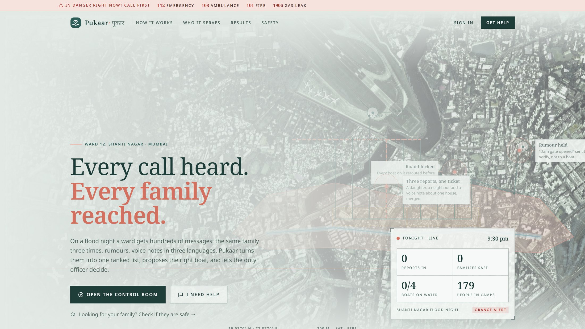

</div>

---

## The problem, in two sentences

In a flood, a ward control room gets hundreds of messages at once: the same family three times, rumours, and voice notes in three languages. Boats then go out in the order calls arrive, so the families in the most danger wait the longest (on our test night, a median of **463 minutes**).

## What Pukaar does about it

Six specialist agents and a planner read every message, merge repeats into **one ticket per family**, rank it with **written reasons**, propose the nearest suitable crew with a route around flooded lanes, and **stop**: nothing moves until a signed-in duty officer approves. Families hear back in their own language, with an OTP so the crew knows they reached the right door. On the same night, the median wait for the most urgent families drops to **20 minutes**.

> Agents do the paperwork. Humans send the boats.

## Contents

- [Screens](#screens)
- [One rescue, end to end](#one-rescue-end-to-end)
- [Architecture](#architecture)
- [The agents](#the-agents)
- [Safety invariants](#safety-invariants)
- [How triage decides](#how-triage-decides)
- [Real-time model](#real-time-model)
- [Security and access](#security-and-access)
- [API](#api)
- [Tech stack](#tech-stack)
- [Project structure](#project-structure)
- [Run it](#run-it)
- [Evaluation](#evaluation)
- [Tests](#tests)
- [Demo film](#demo-film) · [watch on YouTube](https://youtu.be/TGQ5zi1kfI8)
- [What is simulated](#what-is-simulated)
- [Beyond floods](#beyond-floods)

---

## Screens

All screenshots are of the running app, captured by [`video/screens.py`](video/screens.py).

### Control room (`/control`)

The officer's view: tonight's counts, a ranked queue with reason chips, a live map with boats and routes, the selected ticket as a floating card, approval cards, and the agents' activity feed.

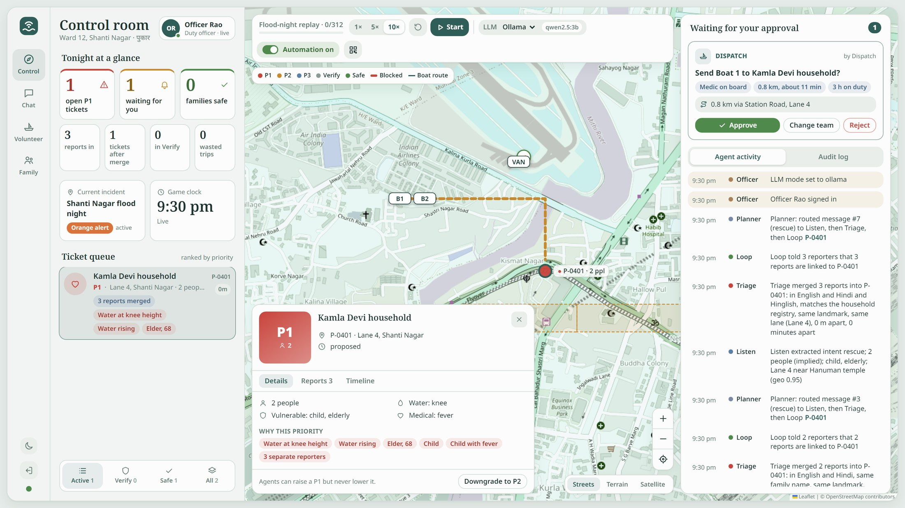

| A busy night at 10× replay | Dark mode |
| --- | --- |
| 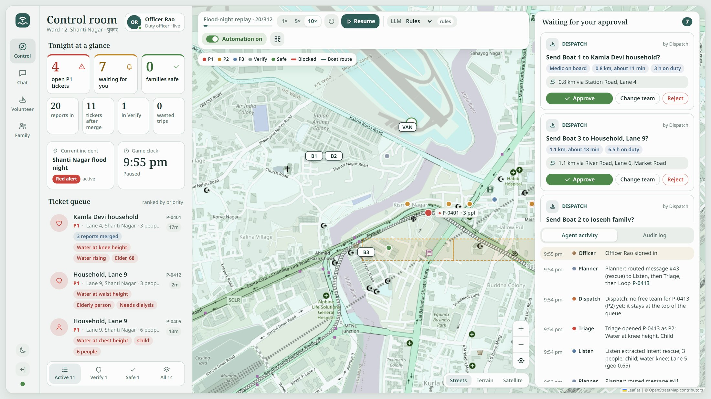 | 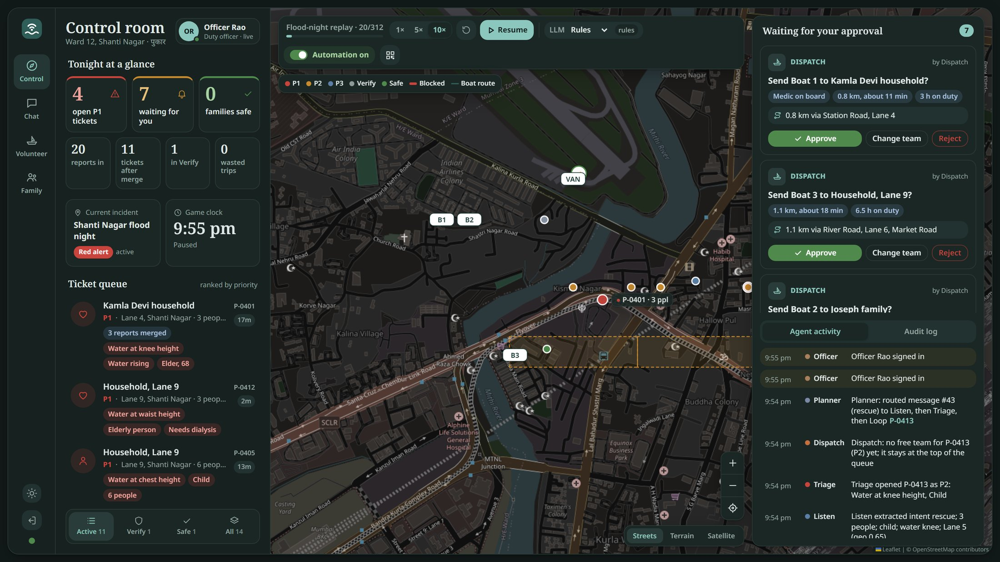 |

| The approval card: one tap sends a boat | The ticket: raw messages beside the extraction |
| --- | --- |
| 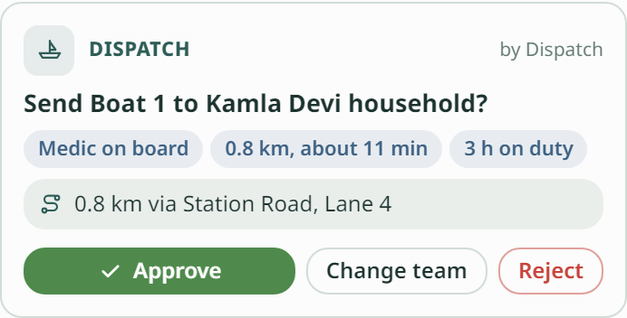 | 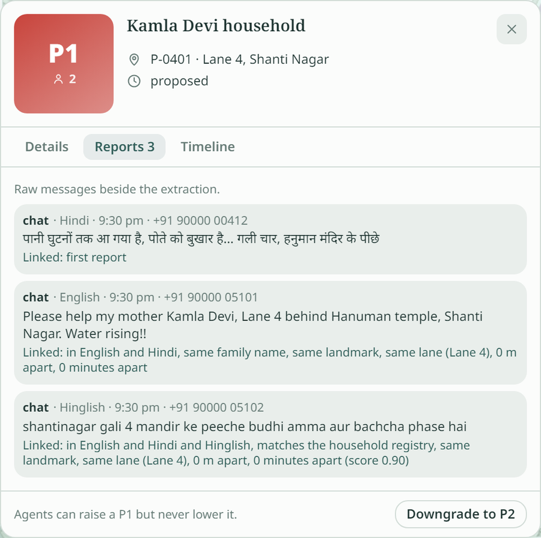 |

Chat, the volunteer desk and the family lookup open as a card inside the control room, so the officer never leaves the map:

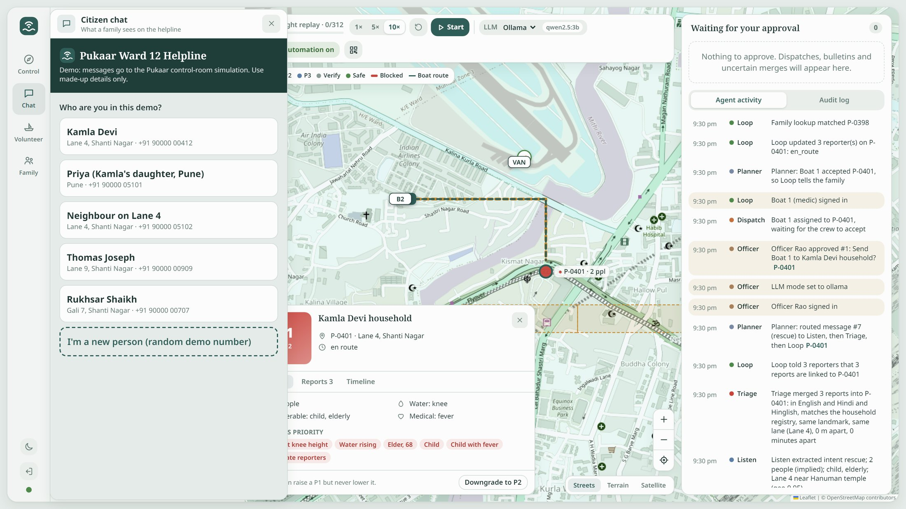

### Phones

| Citizen helpline (`/chat`) | Boat crew desk (`/volunteer`) | Is my family safe? (`/family`) |
| --- | --- | --- |
| 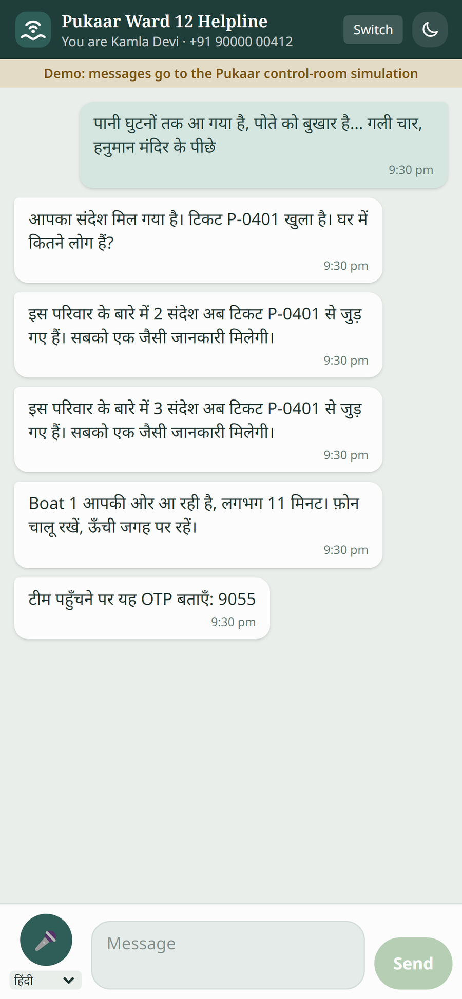 | 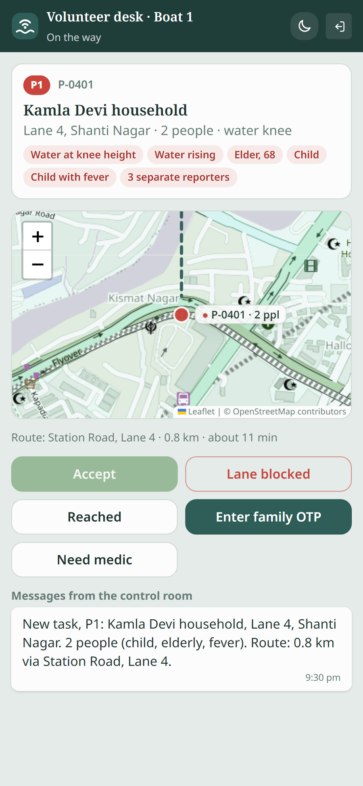 | 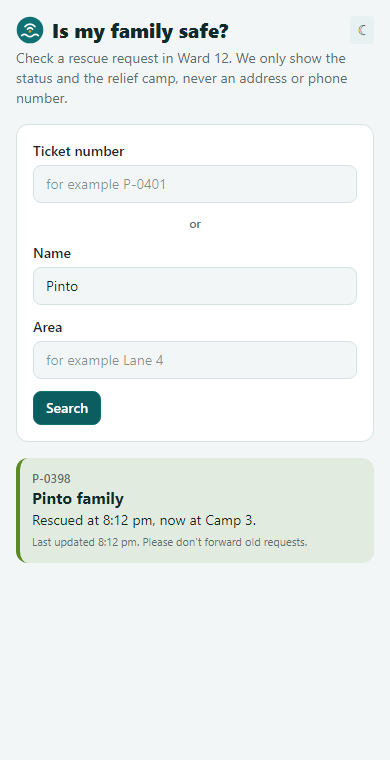 |
| Kamla writes in Hindi. Every reply comes back in Hindi: ticket opened, three reports linked, Boat 1 on the way, the OTP. | The crew sees who is waiting and what they need, the route, and can report a blocked lane. No reporter phone numbers. | Status and camp only. Never an address, never a phone number. |

### Public site and sign-in

| How it works, with snapshots of the real app | Sign-in for officers and crews |
| --- | --- |
| 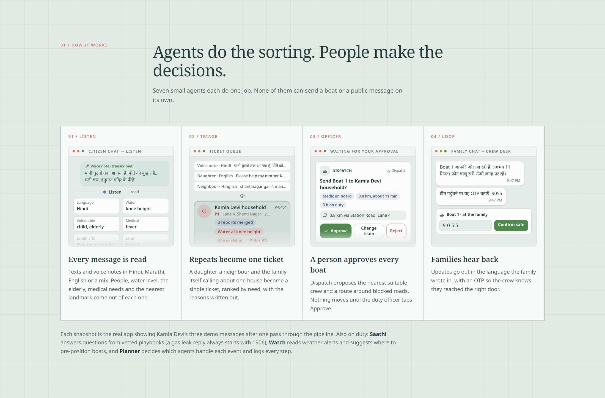 | 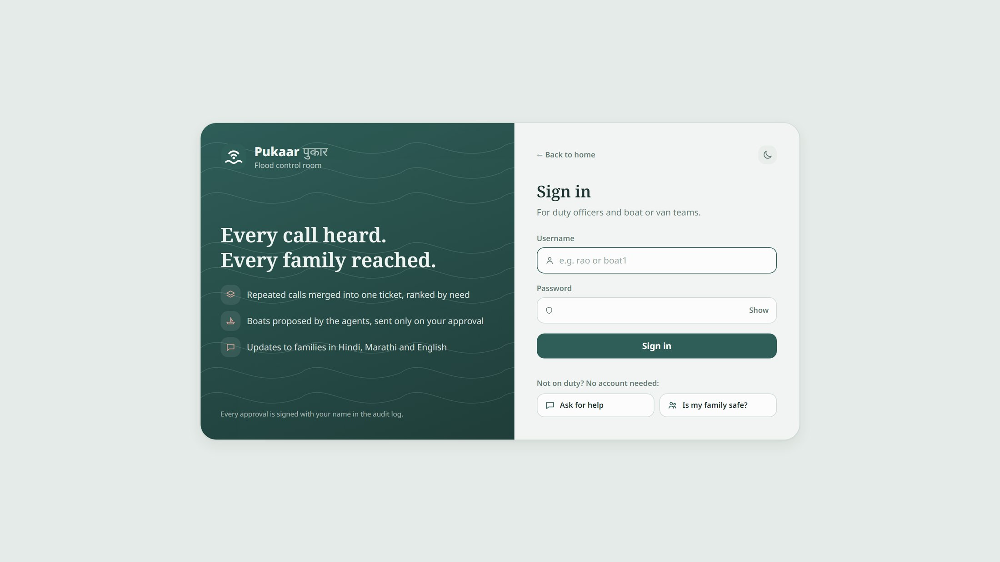 |

---

## One rescue, end to end

Kamla Devi, 68, is on Lane 4 with her grandson, who has a fever. Three people write about her in three languages within a minute.

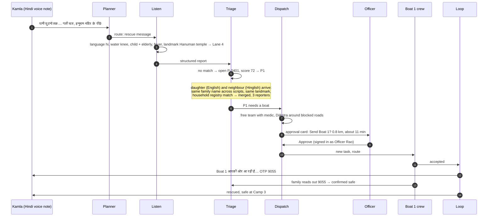

Every arrow is written to the audit log, and every screen updates live over server-sent events.

---

## Architecture

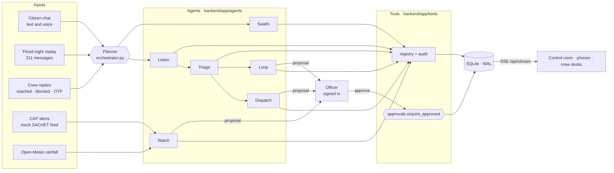

| Layer | Where | Responsibility |
| --- | --- | --- |
| Planner | `backend/app/orchestrator.py` | Receives every event (message, alert, crew action, approval, timer tick), decides which agents run in which order, writes each plan step to the audit log. Events are handled one at a time under a lock, so the replay, the chat and the officer never race. |
| Agents | `backend/app/agents/*.py` | One file per agent, each with a `run(event)` method. Agents never touch the database directly; they call tools. |
| Tools | `backend/app/tools/*.py` | Plain Python functions registered with a name, description and JSON schema. The same registry feeds Ollama tool calling and rules mode. Every call is audited. |
| Human gate | `backend/app/tools/approvals.py` | The only code path that can move a team to `en_route`, mark a bulletin sent, downgrade a P1 or close a ticket without the family. |
| Auth | `backend/app/auth.py` | Accounts, sessions, role checks used as FastAPI dependencies. |
| API and stream | `backend/app/main.py` | REST routes, server-sent events, the built frontend on the same port. |
| Frontend | `frontend/src` | One React app with five surfaces: landing, control room, helpline chat, crew desk, family lookup. |

The gate, in real code (`backend/app/tools/approvals.py`):

```python
def require_approved(approval, kind, ticket_id=None, team_id=None):
    """Raise unless this approval is approved and covers exactly this action."""
    if isinstance(approval, int):
        approval = get(approval)
    if not approval or approval.get("status") != "approved" or approval.get("kind") != kind:
        raise ApprovalRequired(f"'{kind}' needs an approved officer approval")
    if not approval.get("decided_by"):
        raise ApprovalRequired("approval has no deciding officer")
    if ticket_id is not None and approval.get("ticket_id") != ticket_id:
        raise ApprovalRequired("approval is for a different ticket")
    if team_id is not None and approval.get("team_id") != team_id:
        raise ApprovalRequired("approval is for a different team")
    return approval
```

`teams.set_status` calls it before any team can leave, so there is no way around it from an agent, a tool or the model. More detail: [docs/architecture.md](docs/architecture.md).

---

## The agents

| Agent | Job | Tools it may call |
| --- | --- | --- |
| **Planner** | Routes each event to the right agents in order and logs the plan ("routed message #7 (rescue) to Listen, then Triage, then Loop"). | (orchestration only) |
| **Listen** | Detects Hindi, Marathi, Hinglish or English; extracts people, vulnerable members, medical need, water level, landmark, battery and danger words; asks one follow-up if location or head count is missing. | `extract_report`, `geocode_landmark`, `ask_followup` |
| **Triage** | Matches reports to existing tickets, scores priority with written reasons, sends contradicted claims to Verify, recognises reposts about families already safe. | `find_similar_tickets`, `create_ticket`, `merge_into_ticket`, `score_priority`, `flag_for_verification` |
| **Dispatch** | Picks the best free team by skill (a medic for medical needs), road distance and hours on duty; routes around blocked roads; replans; proposes, never sends. Supplies go to the van. | `list_free_teams`, `compute_route`, `create_approval`, `replan_routes` |
| **Loop** | Updates every linked reporter in their language, auto-replies to reposts, answers FAQs, re-pings stale tickets, drafts bulletins. | `send_message`, `draft_bulletin`, `answer_faq` |
| **Saathi** | Safety steps from vetted playbooks only; for gas, fire, live wires or someone unconscious the first line is always the emergency number. | `search_playbook`, `escalate_danger` |
| **Watch** | Reads the CAP feed and rainfall, marks watch zones, keeps area memory of blocked roads (it fades unless confirmed), proposes pre-positioning. | `read_alerts`, `get_rainfall`, `mark_road_blocked`, `propose_preposition` |

The model is never offered a tool that acts on the world: in Ollama mode it can extract fields and pick a playbook, nothing more.

---

## Safety invariants

Each rule is enforced in the backend, not the UI, and has a test.

| Invariant | Enforced in | Proven by |
| --- | --- | --- |
| No team goes `en_route` without an approved approval for exactly that team and ticket | `approvals.require_approved` via `teams.set_status` | `tests/test_safety.py` |
| No public bulletin is marked sent without approval | `orchestrator` → `require_approved(…, "bulletin")` | `tests/test_safety.py` |
| Agents may raise a P1 but never lower it; only an officer can downgrade | `tickets.score_priority`, `tickets.downgrade` → `require_approved(…, "downgrade")` | `tests/test_safety.py` |
| A ticket cannot close without the family's OTP unless an officer approves | `tickets.set_status` → `require_approved(…, "close")` | `tests/test_safety.py` |
| The kill switch stops every outgoing message and every new proposal | `approvals.create_approval`, `messaging` | `tests/test_safety.py` |
| Uncertain or conflicting duplicates are never merged automatically | `Triage` thresholds + identity evidence | `tests/test_safety.py` |
| A new family near a rescued one is never told "already rescued" | identity evidence required for repost matches | `tests/test_safety.py` |
| Saathi's danger replies start with an emergency number and use playbook text only | `Saathi`, `playbooks` | `tests/test_safety.py` (EN, HI, MR) |
| Family lookup never returns an address or phone | `tickets.public_status` | `tests/test_safety.py` |
| Control-room actions need a signed-in officer; approvals are attributed to the session, not a typed name | `auth.require_officer` | `tests/test_auth.py` |

---

## How triage decides

**Priority** is an additive rule set (`tickets.priority_rules`), shown to the officer as chips. P1 at 50 points, P2 at 30.

| Kamla Devi, P-0401 | Points |
| --- | ---: |
| Base | 10 |
| Water at knee height | 12 |
| Water rising | 8 |
| Elder, 68 (from the household registry) | 15 |
| Child | 12 |
| Child with fever | 10 |
| 3 separate reporters | 5 |
| **Total → P1** | **72** |

Other weights include neck-deep water 35, someone unconscious 40, breathing trouble 35, gas leak, fire or live wire 30, dialysis 25, on the roof 25, a phone at 20% battery or less 8, and five or more people 8. Supplies requests are capped below P2 and go to the van.

**Duplicate matching** combines sender, family name across Devanagari and Latin (a consonant skeleton, so पाटिल and Patil match), the household registry, landmark, lane, distance, time and details (people, vulnerable members, medical need, water level), plus embeddings in Ollama mode.

| Match score | What happens |
| --- | --- |
| ≥ 0.60 with identity evidence | Merged automatically, reason written on the ticket |
| 0.35 to 0.60 | "Possible duplicate: merge?" card for the officer |
| ≥ 0.50 to a family already safe, with identity evidence | Treated as a repost: "Rescued at 8:12 PM, safe at Camp 3" |
| Below | New ticket |

**Verify lane.** A claim such as "Powai dam has burst" is checked against the river gauge and the alert feed. Contradicted claims are parked in Verify instead of becoming a rescue call, and repeats of the same rumour join one Verify ticket.

---

## Real-time model

There is one event stream, `GET /api/stream` (server-sent events), filtered per audience on the server:

| Subscriber | Receives | Needs |
| --- | --- | --- |
| Control room | Every agent activity entry and every change | Officer session |
| Crew desk (`?team=boat1`) | Messages for that team and "something changed" pings | That crew's session, or an officer |
| Citizen chat (`?phone=…`) | Only that reporter's own messages | Nothing |

Each screen refetches its view on a ping and keeps a slow three-second heartbeat, so the officer, the family and the crew see the same moment at the same time. A ticker thread advances the game clock, moves boats along the road graph and re-pings stale tickets.

---

## Security and access

- **Roles.** Duty officers (`rao`, `desai`) run the control room. Each crew account (`boat1`, `boat2`, `boat3`, `van1`) sees only its own desk. Citizens and families need no account.
- **Storage.** Passwords are salted PBKDF2-SHA256 (200,000 rounds); session tokens are stored as SHA-256 hashes, so a copy of the database cannot be used to sign in.
- **Sessions.** An HttpOnly, SameSite=Lax cookie that lasts one 12-hour shift, marked Secure automatically behind an HTTPS tunnel.
- **Brute force.** Five wrong passwords lock that username for a minute. Unknown users and wrong passwords get the same answer and timing.
- **Attribution.** Approvals, downgrades, closures and setting changes are recorded under the signed-in officer's name; a name typed into a request body is ignored.
- **Public data.** `/api/public/overview` (used by the landing page) returns the map and night totals only: no family, ticket, message, phone or boat position. A test checks it.

Demo passwords are `pukaar-officer` and `pukaar-volunteer`. **Set your own before sharing a public link:**

```bash
PUKAAR_OFFICER_PASSWORD='…' PUKAAR_VOLUNTEER_PASSWORD='…' ./start.sh
# Windows: $env:PUKAAR_OFFICER_PASSWORD='…'; $env:PUKAAR_VOLUNTEER_PASSWORD='…'; .\start.ps1
```

---

## API

| Method and path | Who | Purpose |
| --- | --- | --- |
| `POST /api/auth/login` · `POST /api/auth/logout` · `GET /api/auth/me` | anyone | Sessions |
| `GET /api/public/overview` | anyone | Map and totals for the landing page |
| `POST /api/messages` | anyone | A citizen message (text or transcribed voice) |
| `GET /api/chat/{phone}` | anyone | That reporter's thread |
| `GET /api/family?name=&area=&ticket=` | anyone | Status and camp only |
| `GET /api/state` | officer | Everything the control room shows, in one call |
| `GET /api/tickets/{id}` | officer | Ticket with raw reports and history |
| `POST /api/approvals/{id}` | officer | Approve or reject, optionally with another team |
| `POST /api/tickets/{id}/downgrade` · `/close` | officer | The two officer-only overrides |
| `GET /api/activity` · `GET /api/audit` | officer | Agent activity and the full audit log |
| `POST /api/settings` | officer | Kill switch, LLM mode |
| `POST /api/replay` · `POST /api/reset` | officer | Replay the night at 1×, 5×, 10× |
| `GET` · `POST /api/volunteer/{team}` | that crew or officer | Task view; accept, reached, blocked lane, OTP |
| `GET /api/stream` | see [Real-time model](#real-time-model) | Server-sent events |

---

## Tech stack

| Area | Choice | Why |
| --- | --- | --- |
| Backend | Python 3.11+, FastAPI 0.115, Uvicorn | Small, typed, async streaming for SSE |
| Storage | SQLite in WAL mode, one guarded connection | Zero setup, survives a laptop restart |
| Matching | RapidFuzz, Devanagari-to-Latin consonant skeletons | Fast fuzzy names across scripts |
| Models | Rules mode by default; optional Ollama (`qwen2.5:3b` or `7b`, `nomic-embed-text`) | Works with no model; nothing leaves the laptop |
| Routing | Dijkstra over the ward road graph | Reroutes instantly when a lane is blocked |
| Weather and alerts | Open-Meteo, mock CAP (SACHET format) | Real rainfall, safe alert data |
| Frontend | React 18, TypeScript 5.6, Vite 6, Tailwind CSS 4.1 | One app, five surfaces |
| Maps | Leaflet 1.9 with OpenStreetMap, OpenTopoMap and Esri imagery | Free tiles, three basemaps |
| Type | Noto Serif and Noto Sans, each with its Devanagari partner | Hindi and Marathi match the English |
| Demo film | Playwright, Kokoro TTS (offline), ffmpeg | Rendered from code, see [video/](video/) |

---

## Project structure

```
pukaar/
├─ backend/
│  ├─ app/
│  │  ├─ main.py            FastAPI routes, SSE stream, serves the built frontend
│  │  ├─ orchestrator.py    the planner: routes every event, one at a time
│  │  ├─ auth.py            accounts, sessions, role checks
│  │  ├─ llm.py             rules / Ollama switch, timeouts, fallback
│  │  ├─ nlp.py · i18n.py   extraction and replies in four languages
│  │  ├─ agents/            listen · triage · dispatch · loop · saathi · watch
│  │  └─ tools/             approvals (the gate) · tickets · teams · geo · messaging · audit · alerts · weather · playbooks
│  ├─ data/                 scenario (ward, roads, households, camps, the 311-message night), playbooks, alerts
│  ├─ scripts/              generate_flood_night.py · evaluate.py
│  └─ tests/                67 tests: safety, auth, pipeline, API, scenario, LLM fallback
├─ frontend/src/
│  ├─ pages/                Landing · Dashboard · Chat · Volunteer · Family · Login
│  └─ components/           WardMap · TicketQueue · TicketDetail · ApprovalCard · MapToolbar · LandingMap …
├─ video/                   the demo film: recorder, narration, mix, composition, renderer
├─ docs/                    architecture · eval report · demo script · screenshots
├─ start.sh · start.ps1     install, build, serve on :8000
└─ go-live.bat              server + public Cloudflare link in two windows (Windows)
```

---

## Run it

You need **Python 3.11+** and **Node.js 18+**. Nothing else for rules mode.

```bash
./start.sh          # macOS or Linux
.\start.ps1         # Windows PowerShell
```

The script creates a virtual environment, installs packages, builds the frontend and serves everything on **http://localhost:8000**.

| Surface | URL | Sign-in |
| --- | --- | --- |
| Landing page | `/` | none |
| Control room | `/control` | `rao` / `pukaar-officer` |
| Crew desk | `/volunteer` | `boat1` / `pukaar-volunteer` |
| Citizen helpline | `/chat` | none |
| Family lookup | `/family` | none |

In the control room, press **Start** in the map toolbar to replay the flood night at 1×, 5× or 10×.

### Ollama mode (optional)

```bash
ollama pull qwen2.5:3b          # or qwen2.5:7b with 16 GB+ RAM (picked automatically)
ollama pull nomic-embed-text    # optional, for duplicate matching
LLM_MODE=ollama ./start.sh      # or: .\start.ps1 -Mode ollama
```

Every model call has a timeout (`LLM_TIMEOUT`, default 6 s). If Ollama is stopped, slow or missing the model, that call falls back to rules and the toolbar says so. `OLLAMA_MODEL` and `OLLAMA_HOST` override the defaults.

### Hosted on Render

The live app runs at **https://pukaar.onrender.com** (rules mode, Singapore region), built from `Dockerfile` with the blueprint in `render.yaml`. It redeploys on every push to `main`. On the free plan it sleeps after about 15 idle minutes, so the first visit can take up to a minute, and the flood night resets on every restart. Set `PUKAAR_OFFICER_PASSWORD` and `PUKAAR_VOLUNTEER_PASSWORD` in Render's Environment tab.

### Public link from your laptop

On Windows, double-click **`go-live.bat`**: it starts the server and a free Cloudflare quick tunnel in two windows and prints a `https://….trycloudflare.com` address. Elsewhere: `cloudflared tunnel --url http://localhost:8000`. The QR code in the control room then points phones at the public helpline. Quick-tunnel addresses change on every restart.

### Development

```bash
cd backend && .venv/bin/python -m uvicorn app.main:app --reload   # API on :8000 (.venv\Scripts on Windows)
cd frontend && npm run dev                                          # Vite on :5173, proxies /api
cd backend && .venv/bin/python -m pytest -q                         # 67 tests
cd backend && .venv/bin/python scripts/generate_flood_night.py     # regenerate the night
cd backend && .venv/bin/python scripts/evaluate.py --modes rules ollama
```

---

## Evaluation

`backend/scripts/evaluate.py` replays the 311-message synthetic night (Hindi, Marathi, Hinglish and English, with hidden ground truth) through the real pipeline and through a first-come-first-served baseline, where every request is a new job and three boats take jobs in arrival order. Full method and results: [docs/eval-report.md](docs/eval-report.md).

| Measure | First come, first served | Pukaar (rules) | Pukaar (Ollama, qwen2.5:3b) |
| --- | ---: | ---: | ---: |
| Requests turned into jobs or tickets | 210 | 101 | 107 |
| Duplicate-merge F1 (after officer review) | 0 | 0.79 | 0.68 |
| **Median time to assign a P1 family** | **463 min** | **20 min** | 28 min |
| 90th percentile time to assign a P1 family | 1253 min | 172 min | 154 min |
| P1 families assigned by the end | 28/28 | 25/28 | 23/28 |
| Boat or van trips | 210 | 56 | 53 |
| **Wasted trips** (already rescued, rumour or duplicate) | **131** | **15** | 17 |
| Supplies requests sent on rescue boats | 24 | 0 | 0 |
| **Rumours caught in Verify** | **0/15** | **15/15** | 15/15 |

How to read it honestly:

- These are real numbers from a **synthetic** night, not field results. The rules extractor and the message generator share vocabulary, so rules-mode field accuracy (98.2%) is an upper bound.
- The baseline reaches all 28 P1 families only because it keeps running about 21 hours past the night; Pukaar is scored up to 90 minutes after the last message.
- Merge F1 is after a simulated officer reviews "possible duplicate" cards; automatic merges alone score 0.57 in rules mode.
- The Ollama column used `qwen2.5:3b` (10 of 317 calls fell back to rules). It trails rules mode here mainly on people counts (71.7% against 99.4%); a whole-night run took about 28 minutes against 16 seconds.

---

## Tests

```bash
cd backend && .venv/bin/python -m pytest -q      # 67 passed
```

| File | Tests | Covers |
| --- | ---: | --- |
| `test_auth.py` | 23 | Every officer route refuses anonymous and crew sessions, crew isolation, attribution, lockout, hashed storage, public overview has no personal data |
| `test_safety.py` | 21 | Every invariant in [Safety invariants](#safety-invariants) |
| `test_pipeline.py` | 10 | Kamla's three messages to one P1, replies per language, medic boat waits for the officer, full rescue with Lane 6 blocked and OTP, Pinto repost, dam rumour, follow-up questions, red alert, gas leak |
| `test_scenario.py` | 8 | Seed data, geocoding Hindi landmarks, lane parsing across scripts, routing around Lane 6, fading road memory, alert clock, playbook search |
| `test_llm.py` | 3 | Ollama timeouts and fallback to rules |
| `test_api.py` | 2 | Messages to approval to crew view to family lookup over HTTP |

---

## Demo film

**Watch it: https://youtu.be/TGQ5zi1kfI8**

A 4:41 film, rendered entirely from code in [`video/`](video/): real screen recordings of the control room and two phones in sync, motion graphics, an offline voiceover (Kokoro, with Kamla's line in Hindi) and burned-in captions. The MP4 itself is not committed; rebuild it with the steps in [video/README.md](video/README.md). A three-minute live walkthrough is in [docs/demo-script.md](docs/demo-script.md).

---

## What is simulated

- **Ward 12, Shanti Nagar is fictional.** It is placed on the Kurla stretch of the Mithi river in Mumbai, but its lanes, landmarks and road graph are invented and do not match the streets under the map. Every household, name and message is made up; every phone number uses the fake pattern `+91 90000 xxxxx`.
- **Channels.** WhatsApp, SMS and calls are represented by a web chat and by labels on replayed messages. No real messaging service is connected.
- **Voice notes** use the browser's own speech recognition (Chrome, Edge or Safari). The replay contains already-transcribed text.
- **Alerts and sensors.** CAP alerts and the river gauge are mock files in real formats. Rainfall is live from Open-Meteo, falling back to mock figures offline.
- **Teams** move along the road graph on a game clock.
- **Translations.** The Hindi and Marathi playbooks and templates were written from standard public guidance (NDMA, LPG and fire-service advice) and **should be checked by a native speaker** before real use.
- **Heatwave mode** is not built; Saathi has a heat playbook only.

Network calls: map tiles (OpenStreetMap, OpenTopoMap, Esri), Google Fonts, Open-Meteo and a local Ollama server. No message, ticket or personal data leaves the machine.

---

## Beyond floods

The agents are disaster-agnostic; the ward map, the playbooks and the scoring weights are data. Swap them and the same pipeline could serve:

| Disaster | What changes |
| --- | --- |
| Cyclone | Watch pre-positions boats before landfall from the alert feed |
| Earthquake | Triage weights trapped people and injuries; Dispatch routes around collapsed roads |
| Heatwave | Saathi points people to the nearest cooling centre; Loop sends welfare checks to the elderly |
| Urban fire | Dispatch routes crews around smoke and blocked lanes; Saathi gives evacuation steps |

---

<div align="center">

Built by **Team Seekers** for AgentX Hackathon 2026.

*Pukaar means "a call for help". We make sure every one is answered.*

</div>
