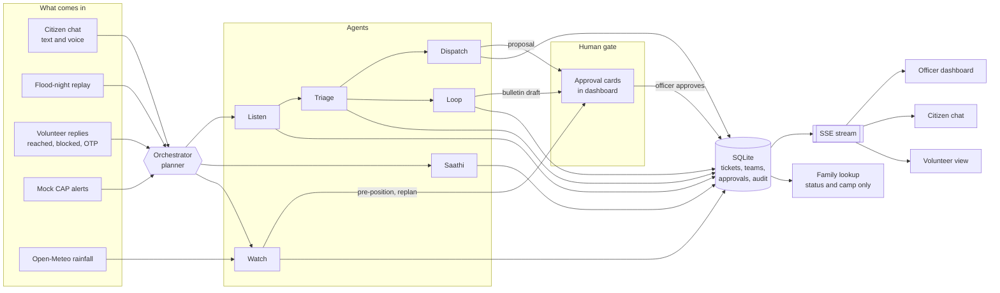

# Pukaar architecture

Pukaar turns every call for help during a flood night into one ticket, ranks it with reasons, proposes a rescue team, waits for an officer to approve, keeps every reporter informed in their own language, and closes the ticket when the family is safe.

This document describes what is actually built for the hackathon. The idea deck (`idea-deck.pptx`, text in `deck-text.md`) describes the product vision; where the two differ, the build brief wins. The main differences are listed at the end.

## Components

| Component | Where | What it does |
| --- | --- | --- |
| API and live stream | `backend/app/main.py` | FastAPI routes for every app, plus one server-sent events stream (`/api/stream`) that pushes ticket, team, approval and activity changes to every open screen. In demo mode it also serves the built frontend, so one port is enough for a tunnel. |
| Database | `backend/app/db.py` | SQLite file (`backend/pukaar.db`) with the tables from the brief. Reset from the scenario on every replay. |
| Orchestrator (planner) | `backend/app/orchestrator.py` | Receives events (citizen message, alert, volunteer reply, approval, timer tick), decides which agents run in which order, and writes each plan step to the audit log. |
| LLM interface | `backend/app/llm.py` | One interface with two modes. `ollama`: local model through Ollama's chat API with tool calling. `rules`: deterministic rules and fuzzy matching. Every LLM call has a short timeout and falls back to rules on any error. |
| Agents | `backend/app/agents/` | Listen, Triage, Watch, Dispatch, Loop, Saathi. Each has a `run(event)` method and only touches the world through tools. |
| Tools | `backend/app/tools/` | Plain Python functions registered with a name, description and JSON schema. The same registry feeds Ollama tool calling and rules mode. Every call is written to the audit log. |
| Approval gate | `backend/app/tools/approvals.py` | The only code path that can move a team to `en_route`, mark a bulletin sent, downgrade a P1 or close a ticket without the family. It requires an approval row with status `approved`, set by an officer through the API. |
| Scenario data | `backend/data/` | Ward 12, Shanti Nagar: road graph, landmarks with Hindi, Marathi and Hinglish names, households, teams, camps, playbooks, mock CAP alerts. |
| Replay and evaluation | `backend/scripts/` | A seeded generator for a ~300 message flood night with ground truth, and an evaluator that compares Pukaar to a first-come-first-served baseline. |
| Frontend | `frontend/` | React, Vite, TypeScript, Tailwind, Leaflet with OpenStreetMap tiles. Routes: `/` officer dashboard, `/chat` citizen chat, `/volunteer` volunteer tasks, `/family` "Is my family safe?" lookup. |

## Data flow

1. A message arrives from the citizen chat, the replay or a volunteer screen and becomes an event.
2. The orchestrator plans the agents for that event and logs the plan ("Planner: routed message to Listen, then Triage").
3. **Listen** detects the language, extracts a structured report and geocodes the landmark. If the location or the number of people is missing, it asks one follow-up question in the sender's language and holds the report until the answer arrives (or a timeout).
4. **Saathi** runs if the message asks "what do I do" or contains danger words (gas, fire, unconscious). It answers only from playbook text, puts the emergency number first, and escalates the ticket.
5. **Triage** looks for an existing ticket for the same family (landmark distance, fuzzy name match, same sender, embeddings when available). Confident matches merge with a written reason; uncertain ones become a "Possible duplicate: merge?" card for the officer. It scores priority with an additive rule set, sends claims that contradict sensor data to the verify lane, and hands reposts about families already safe to Loop.
6. **Dispatch** picks the best free team (skill, road distance, hours on duty), computes a route around blocked roads, and creates an approval request. It cannot change a team's status.
7. The officer approves in the dashboard. Only then does the approval gate move the team to `en_route`.
8. **Loop** sends a status update to every reporter linked to the ticket, in their language, answers reposts and FAQ questions, re-pings stale tickets, and drafts bulletins that wait for approval.
9. **Watch** reads the mock CAP feed and Open-Meteo rainfall, opens the incident, keeps area memory (blocked roads and water depth that fade unless confirmed), proposes pre-positioning, and triggers replanning when a road is blocked.
10. The volunteer marks "Reached" and enters the family's OTP. The ticket moves to `safe`, and Loop tells every linked reporter.

Every agent action goes into `audit_log`, and the dashboard shows it as a readable activity feed.

## Safety rules and where they are enforced

| Rule | Enforced in |
| --- | --- |
| No team goes `en_route` without an approved approval | `tools/approvals.py` and `tools/tickets.py` (team status setter checks the approval row) |
| Bulletins are never marked sent without approval | `tools/approvals.py` |
| Kill switch off: nothing is sent, no new proposals | `tools/messaging.py` and `tools/approvals.py` check `settings.automation` before acting |
| P1 downgrade and closing without the family need approval | `tools/tickets.py` |
| Low-confidence duplicates are not merged automatically | `agents/triage.py` (threshold) and `tools/tickets.py` |
| Family lookup never returns an address or phone | `main.py` lookup route returns a fixed whitelist of fields |
| Saathi answers only from playbooks, emergency number first | `agents/saathi.py` |

Each rule has a pytest test in `backend/tests/`.

## LLM modes

- `LLM_MODE=rules` (default): keyword and pattern extraction in four languages, rapidfuzz matching, and template replies. No model needed.
- `LLM_MODE=ollama`: the agents send the message and their tool schemas to a local model (`qwen2.5:3b` on this machine, which reports 15.6 GB of RAM; `qwen2.5:7b` on 16 GB or more) and run the tool calls it returns. Embeddings come from `nomic-embed-text` when it is pulled.
- If Ollama is unreachable or a call takes longer than the timeout (4 seconds by default), that call falls back to rules and the dashboard header shows the fallback.
- The model never gets to bypass the approval gate: tools that change team status or send bulletins are not exposed to the model at all.

## Where this differs from the deck

| Deck says | Built instead | Why |
| --- | --- | --- |
| WhatsApp Cloud API / Twilio SMS and voice | A WhatsApp-style web chat (`/chat`) with browser speech recognition | No API keys or paid services |
| OSRM / OpenRouteService routing | Dijkstra over a hand-built ward road graph | Runs offline |
| Nominatim geocoding | Landmark gazetteer with Hindi, Marathi and Hinglish spellings | Runs offline; landmarks are how people actually give addresses |
| Whisper / Bhashini speech | Browser Web Speech API (`hi-IN`, `mr-IN`, `en-IN`) | No server-side model needed |
| Postgres + PostGIS | SQLite | One file, no install |
| LangGraph | A small hand-written orchestrator | Fewer dependencies, easier to read |
| Heatwave mode | Heat playbook for Saathi only; check-in mode is a stretch goal | Scope |
